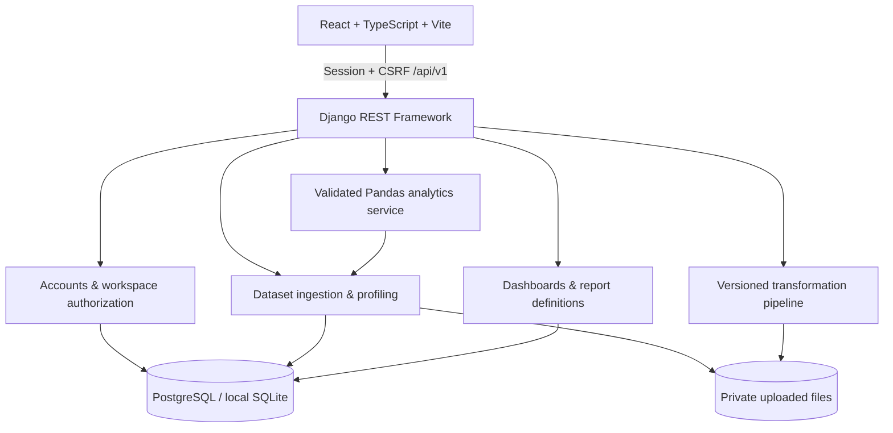

# InsightFlow BI

**A portfolio-grade business intelligence workspace built with Django REST Framework, React, TypeScript, Pandas, and Recharts.** Upload tabular data, inspect its quality, apply reproducible preparation steps, query grouped metrics, and save dashboard/report definitions.

> Status: working MVP under active development. The implementation intentionally documents unfinished capabilities rather than claiming every feature in the original product brief is complete. Review [Known limitations](#known-limitations) before using this in production.

## Product overview

InsightFlow BI is designed for analysts, operations teams, and small businesses that need a clear path from CSV/XLSX files to trustworthy summaries. The core flow is upload → profile → transform → aggregate → visualize → save/export.

### Implemented

- Django session authentication, registration, logout, profile/current-workspace endpoint, password hashing, password-strength validation, CSRF middleware, and endpoint throttling.
- Workspaces and server-side membership authorization with owner, administrator, analyst, and viewer roles. Resource reads and writes check workspace membership; write operations exclude viewers.
- Private, UUID-named file storage for uploads; CSV and XLSX parsing; bounded file size and row/column limits; CSV delimiter/encoding detection; dataset preview and deletion.
- Actual-data profiling: null counts/percentages, unique values, numeric summaries/percentiles, category frequencies, duplicates, constant columns, and a transparent completeness/duplicate-based quality score.
- Reproducible transformations: duplicate removal, missing-value handling, column rename/drop, string trimming, type conversion, numeric filters, preview, and saved transformation pipeline. Original uploaded files remain intact.
- Parameter-validated analytics: grouping, filtering, count/distinct count/sum/mean/min/max/median, bounded result count, and data-driven charts.
- Dashboard CRUD, saved report definitions, CSV exports with formula-injection neutralization, XLSX report exports, and seeded recruiter demo workspace.
- React/TypeScript landing, authentication, overview, dataset library, upload, profile, preview, preparation studio, analytics explorer, dashboard, reports, team overview, and settings screens.
- Dockerfiles, Docker Compose, GitHub Actions, backend/frontend tests, and architecture/security/deployment documentation.

### Current limitations

- Excel upload currently selects the first worksheet; worksheet selection and legacy `.xls` support are not enabled. `.xls` is rejected in the current upload UI/API. Workbook formulas are not recalculated; formula cells may be read as formula text and should be converted to values in the source workbook for analysis.
- The API processes supported uploads synchronously with a conservative 10 MiB upload limit and a 500,000-row parse cap. Celery/Redis ingestion jobs are not wired up yet.
- Data is re-read from the private source file for analytics and transformed in memory. A durable analytical columnar store, incremental processing, and larger-than-memory ingestion are future work.
- Transformation preview supports a bounded list of explicit operations. Arbitrary expressions are intentionally not accepted. Undo/history/version snapshots beyond the saved reproducible pipeline are not yet implemented.
- Dashboard CRUD and analytics queries are real, but the grid editor, drag/resize, cross-filtering, rich date comparisons, and a general chart-spec builder remain incomplete. The demo dashboard can display seeded charts.
- Report creation stores a report definition and provides XLSX/CSV exports. A designed PDF report, asynchronous export status/history, and advanced period/filter snapshots are not implemented.
- Password reset email, email verification, invitations, membership administration, full audit-event instrumentation, rate limiting at the reverse proxy, and object-storage integration need additional work.
- The local SQLite path is provided for easy development. PostgreSQL is the intended deployment database. The Docker Compose deployment has not been validated in this environment unless stated in the delivery report.

## Architecture



## Quick start (local)

Prerequisites: Python 3.12 recommended (Python 3.11+ may work with compatible wheels), Node.js 22, and npm.

```bash
# From the repository root
python -m venv .venv
# Windows PowerShell: .venv\Scripts\Activate.ps1
# macOS/Linux: source .venv/bin/activate
python -m pip install -r backend/requirements.txt
cd backend
python manage.py migrate
python manage.py seed_demo
python manage.py runserver
```

In a second terminal:

```bash
cd frontend
npm install
npm run dev
```

Open `http://localhost:5173`. The API is at `http://localhost:8000/api/v1/` and health is at `http://localhost:8000/health/`.

### Development demo login

- Email: `demo@insightflow.local`
- Password: `InsightFlow-Demo-2026!`

These credentials are for local demo use only. Never deploy the seeded password to a public service. The seed command is deterministic and creates synthetic, not customer, data. Re-running without `--reset` preserves existing demo data. `python manage.py seed_demo --reset` deletes and recreates only the dedicated `insightflow-demo` workspace; it is not a generic user-data reset.

## Docker Compose

```bash
cp .env.example .env
# Edit .env and replace all development secrets before any shared deployment.
docker compose up --build -d
docker compose exec backend python manage.py seed_demo
```

Frontend: `http://localhost:5173`; API: `http://localhost:8000`. The backend container migrates at startup. Compose uses PostgreSQL and persistent volumes for database and private files. The current frontend calls the API using `VITE_API_URL`; set it to the externally reachable API URL before building the frontend image. Production should terminate TLS at a trusted reverse proxy and set `DJANGO_DEBUG=0`, a strong `DJANGO_SECRET_KEY`, restrictive `DJANGO_ALLOWED_HOSTS`, `CSRF_TRUSTED_ORIGINS`, and `CORS_ALLOWED_ORIGINS`.

## API quick reference

All routes are prefixed `/api/v1/`. Private routes use Django session authentication and CSRF for unsafe requests.

| Method | Endpoint | Purpose |
|---|---|---|
| GET | `/auth/csrf/` | Obtain CSRF cookie/token |
| POST | `/auth/register/` | Register user and create an owner workspace |
| POST | `/auth/login/` | Create authenticated session |
| POST | `/auth/logout/` | End session |
| GET | `/auth/me/` | Current user and memberships |
| GET/POST | `/workspaces/` | List/create workspaces |
| GET | `/datasets/?workspace={id}` | List authorized datasets |
| POST | `/datasets/upload/` | Upload CSV/XLSX (multipart) |
| GET/DELETE | `/datasets/{id}/` | Inspect/delete dataset |
| GET | `/datasets/{id}/preview/` | Paginated data preview (`limit` ≤ 200) |
| GET | `/datasets/{id}/profile/` | Data-quality profile |
| POST | `/datasets/{id}/transform/preview/` | Validate and preview a pipeline |
| POST | `/datasets/{id}/transform/save/` | Persist a reproducible pipeline |
| GET | `/datasets/{id}/export.csv` | Export processed CSV |
| POST | `/analytics/query/` | Filter, group, aggregate actual rows |
| GET | `/analytics/summary/?workspace={id}` | Workspace summary |
| GET/POST | `/dashboards/?workspace={id}` | List/create dashboards |
| GET/PATCH/DELETE | `/dashboards/{id}/` | Read/update/delete dashboard |
| GET/POST | `/reports/?workspace={id}` | List/create report definitions |
| GET | `/reports/{id}/export.xlsx` | Authorized XLSX export |

Development browsable API is available when `DJANGO_DEBUG=1`. A generated OpenAPI schema endpoint is not wired up in this MVP.

## Commands and verification

```bash
# Backend
cd backend
python manage.py check
python manage.py makemigrations --check --dry-run
python manage.py test

# Frontend
cd frontend
npm test
npm run build
```

`Makefile` provides shortcuts for common tasks. Read [docs/testing.md](docs/testing.md) for test scope and [docs/deployment.md](docs/deployment.md) for operational guidance.

## Screenshots

No screenshots are committed yet. To capture portfolio images, run the app with seeded demo data and capture (1) overview, (2) dataset quality profile, (3) analytics explorer, and (4) saved dashboard at desktop and mobile widths. Do not present the landing page's illustrative hero chart as real demo output; in-product dashboard charts query the seeded data.

## Portfolio case study

See [docs/portfolio-case-study.md](docs/portfolio-case-study.md). The case study describes the implemented workflow and engineering trade-offs; it intentionally leaves measured performance and business impact blank until you run reproducible benchmarks.

## License

MIT. See [LICENSE](LICENSE).
