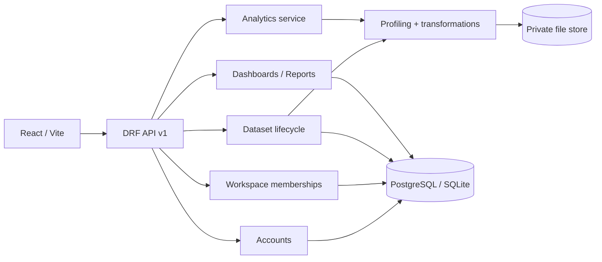

# Architecture

InsightFlow BI is a modular monolith: React/TypeScript UI → versioned DRF endpoints → domain-oriented Django apps. This keeps the deployment simple while isolating accounts/workspaces, dataset lifecycle, analytics, dashboards, reports, and audit model boundaries.

## Trust boundaries

- Browser requests are untrusted; input is validated server-side.
- Session identity comes from Django authentication. CSRF middleware protects cookie-authenticated write requests.
- Every workspace-scoped object access checks membership in the API; frontend navigation is not a security boundary.
- Uploads are private, internally renamed, extension/size checked, and never executed. CSV exports neutralize formula-leading strings.
- DataFrame operations use explicit operation allowlists; no arbitrary Python expressions or SQL are evaluated.

## Domain ownership

- `accounts`: registration, login/logout, current user and CSRF bootstrap.
- `workspaces`: workspace and unique user membership role.
- `datasets`: private upload, preview, profiling, transformation pipeline and processed CSV.
- `analytics`: bounded group/filter/aggregation service.
- `dashboards`: saved dashboard configuration.
- `reports`: saved report definition and XLSX export.
- `audit`: audit event schema; automatic instrumentation is not complete yet.

The current data engine re-reads the private original file and applies the saved transformation pipeline at query time. This is simple and reproducible for the MVP upload limit; it should evolve to versioned Parquet/object storage and asynchronous workers before large workloads.
