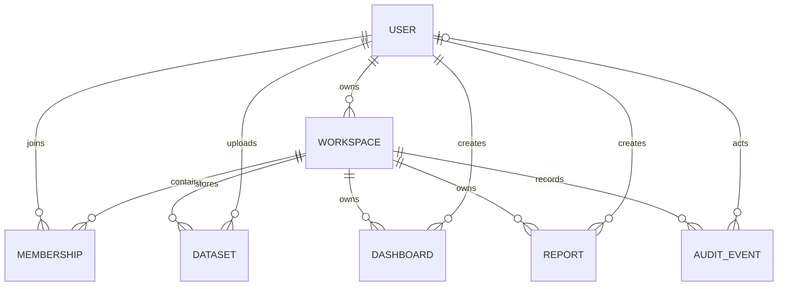

# Database design

## Main entities

- **User**: Django auth user; username is normalized email in the registration flow. Passwords use Django's password hashers.
- **Workspace**: human-readable name, unique slug, creator and timestamp.
- **Membership**: unique `(workspace, user)` pair and role (`owner`, `administrator`, `analyst`, `viewer`).
- **Dataset**: workspace, creator, internal private file path, format, ingestion status, row/column metadata, JSON column schema and JSON pipeline.
- **Dashboard**: workspace, creator, name/description and JSON configuration; dashboard chart query configurations reference dataset IDs.
- **Report**: workspace, creator, title, dataset ID and report configuration. Dataset IDs are currently a scalar; report export explicitly scopes the lookup to the report's workspace.
- **AuditEvent**: workspace, actor, action/resource identifiers and timestamp. The model exists; complete write-path event emission is future work.

## Constraints and indexes

Django's primary keys and the membership uniqueness constraint are enforced. Production hardening should add explicit indexes for high-volume workspace/time lookups, enforce dataset/report references with a workspace-aware relational design, and define retention policies before multi-tenant production use.
